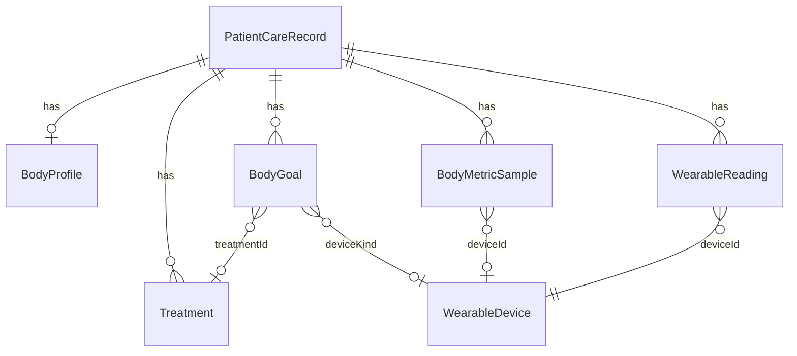

# Body / Goals Data Model — Extending `patientCareStore`

> **Status:** R&D schema proposal. Tiny TypeScript snippets are illustrative only — not implemented on this branch.  
> **Baseline:** `src/lib/patientCareStore.ts` (`PatientCareRecord`, localStorage key `sprymd_patient_care_v1`), `src/types/dashboard.ts`, wearable branch additions (`wearableDevices`, `wearableReadings`).

---

## 1. Problem

The care store today models **protocols & commerce**:

- `treatments` (medication + free-text `goal`)
- `shipments`, `subscriptions`, `transactions`
- `notifications`, `messages`, `clinicalCases`
- *(wearable branch)* `wearableDevices`, `wearableReadings`

Missing for a Kraken-style **Balances** panel and goal progress:

- Anthropometrics (height, weight history, BMI)
- Structured body / biometric **goals** (target, band, deadline)
- Linkage from goals → devices / treatments
- Provenance for simulated vs real readings

---

## 2. Design principles

1. **Additive migration** — new fields optional; backfill on read like wearables.  
2. **Single care record per email** — keep `PatientCareRecord` as aggregate root.  
3. **Derived BMI** — store height + weight points; compute BMI at read time.  
4. **Goals are first-class** — do not overload `Treatment.goal` string for body targets (keep treatment goal as clinical intent copy).  
5. **Readings remain the time-series** — body weight goals consume `wearableReadings` / `bodyMetrics` events, not a parallel undocumented store.  
6. **Units** — store canonical (`cm`, `kg`) + display preference (`ft_in`, `lb`).

---

## 3. Proposed types

```ts
/** Canonical metric identifiers shared with wearables catalog */
export type MetricKey =
  | "hr"
  | "hrv"
  | "spo2"
  | "bp_sys"
  | "bp_dia"
  | "weight"
  | "body_fat"
  | "bmi"
  | "sleep_score"
  | "sleep_hours"
  | "skin_temp_delta"
  | "glucose"
  | "strain"
  | "recovery"
  | "steps"
  | "active_kcal"
  | "ahi"
  | "cpap_usage_hr";

export type UnitSystem = "imperial" | "metric";

export interface BodyProfile {
  heightCm: number | null;
  /** Display preference only; storage stays metric */
  unitSystem: UnitSystem;
  sexAtBirth?: "female" | "male" | "intersex" | "unspecified";
  dateOfBirth?: string; // ISO date — may already live on customer profile
  notes?: string;
  updatedAt: string;
}

export interface BodyMetricSample {
  id: string;
  metric: MetricKey;
  value: number;
  /** Always SI-ish canonical: kg for weight, cm unused here, % for fat, etc. */
  unit: string;
  source: "manual" | "device" | "import" | "derived";
  deviceId?: string; // WearableKind or catalog sku
  recordedAt: string;
  createdAt: string;
  provenance?: "user" | "clinician" | "simulated";
}

export type GoalStatus = "active" | "paused" | "hit" | "missed" | "cancelled";
export type GoalDirection = "at_or_below" | "at_or_above" | "in_range" | "maintain";

export interface BodyGoal {
  id: string;
  title: string;
  metric: MetricKey;
  direction: GoalDirection;
  /** Primary target (e.g. weight kg) */
  targetValue?: number;
  /** For in_range */
  rangeMin?: number;
  rangeMax?: number;
  unit: string;
  startValue?: number;
  startAt: string;
  targetAt?: string; // deadline
  status: GoalStatus;
  /** Optional links */
  treatmentId?: string;
  deviceKind?: string;
  createdAt: string;
  updatedAt: string;
}

export interface GoalProgressSnapshot {
  goalId: string;
  currentValue: number | null;
  /** 0–1 clamped; null if unknown */
  progress: number | null;
  deltaFromStart: number | null;
  deltaFromTarget: number | null;
  asOf: string;
}
```

### Extend `PatientCareRecord`

```ts
export interface PatientCareRecord {
  email: string;
  treatments: Treatment[];
  notifications: NotificationItem[];
  shipments: Shipment[];
  subscriptions: Subscription[];
  messages: MessageThread[];
  transactions: Transaction[];
  clinicalCases: ClinicalCase[];
  // wearable branch
  wearableDevices?: WearableDevice[];
  wearableReadings?: WearableReading[];
  // NEW
  bodyProfile?: BodyProfile;
  bodyMetrics?: BodyMetricSample[]; // optional dedicated series; or derive weight from readings
  bodyGoals?: BodyGoal[];
  updatedAt: string;
}
```

### Extend `DashboardData`

Mirror the new fields onto `DashboardData` so `useDashboardData` / terminal panels stay one hop from the store.

---

## 4. BMI & derived metrics

```ts
export function bmiFromMetric(heightCm: number, weightKg: number): number {
  const m = heightCm / 100;
  return Number((weightKg / (m * m)).toFixed(1));
}
```

Rules:

- If `bodyProfile.heightCm` missing → BMI panel shows “Add height”.  
- Latest `weight` from `bodyMetrics` **or** `wearableReadings` where `metric` maps to weight (smart scale).  
- Prefer `bodyMetrics` when `provenance === "clinician"` for clinical exports.  
- Store derived BMI samples optionally with `source: "derived"` when height or weight changes (debounced).

Imperial display helpers (not stored):

- `cm → ft'in"`  
- `kg → lb` (`lb = kg * 2.20462`)

---

## 5. Goal progress algorithm

```ts
function progressForGoal(goal: BodyGoal, current: number | null): number | null {
  if (current == null || goal.startValue == null) return null;
  if (goal.direction === "in_range" && goal.rangeMin != null && goal.rangeMax != null) {
    if (current >= goal.rangeMin && current <= goal.rangeMax) return 1;
    const mid = (goal.rangeMin + goal.rangeMax) / 2;
    const dist = Math.abs(current - mid);
    const half = (goal.rangeMax - goal.rangeMin) / 2 || 1;
    return Math.max(0, 1 - dist / (half * 3)); // soft falloff
  }
  if (goal.targetValue == null) return null;
  const start = goal.startValue;
  const target = goal.targetValue;
  if (start === target) return current === target ? 1 : 0;
  const raw = (start - current) / (start - target); // works for loss or gain
  return Math.min(1, Math.max(0, raw));
}
```

Auto-status:

- `hit` when progress ≥ 1 for N consecutive days (configurable; default 1 day for MVP)  
- `missed` if `targetAt` passed and progress < 1  
- Manual `paused` / `cancelled` via UI

---

## 6. Store API surface (proposed)

All functions follow existing patterns: `getPatientCare` → mutate → `saveCare` → optional `pushNotification`.

| Function | Behavior |
| --- | --- |
| `getBodyProfile(email)` | Return profile or default empty |
| `updateBodyProfile(email, patch)` | Merge height/units; recompute BMI sample |
| `recordBodyMetric(email, sample)` | Append to `bodyMetrics` (cap 500) |
| `listBodyGoals(email)` | Filter active by default |
| `upsertBodyGoal(email, goal)` | Create/update; set `startValue` from latest metric if omitted |
| `setBodyGoalStatus(email, id, status)` | Status transition + notification |
| `getGoalProgress(email, id)` | Compute `GoalProgressSnapshot` |
| `buildDashboardForEmail` | Include `bodyProfile`, `bodyGoals`, latest metrics |

Migration in `getPatientCare`:

```ts
if (!care.bodyProfile) {
  care.bodyProfile = {
    heightCm: null,
    unitSystem: "imperial",
    updatedAt: new Date().toISOString(),
  };
}
care.bodyMetrics = care.bodyMetrics || [];
care.bodyGoals = care.bodyGoals || [];
```

Storage key can stay `sprymd_patient_care_v1` (additive JSON). If shape thrash becomes painful, bump to `_v2` with one-shot copy.

---

## 7. Relationship to treatments & wearables



Examples:

- GLP-1 treatment `tx_123` ↔ body goal `goal_wt_loss` (`metric: weight`, `direction: at_or_below`, `targetValue: 80` kg).  
- Omron device ↔ goal `bp_sys` in_range 110–130.  
- Weight readings from Withings land as `WearableReading` **and** optionally mirrored to `BodyMetricSample` via adapter for Balances panel simplicity.

**Recommendation:** For MVP, Balances panel reads:

1. Height from `bodyProfile`  
2. Weight / fat from latest wearable reading on `smart_scale` **or** latest `bodyMetrics`  
3. Goals from `bodyGoals`  
4. Treatments still from `treatments` (Positions panel)

---

## 8. Action dock → store flows

| UI action | Store call |
| --- | --- |
| Set height | `updateBodyProfile` |
| Log weight manually | `recordBodyMetric` + optional `recordWearableReading` |
| Set weight goal | `upsertBodyGoal` |
| Buy device | existing cart + later attach `wearableDevices` entry by SKU |
| Upload CSV | existing `importWearableUpload` → refresh goal progress |
| Continuous tick | wearable sync/tick → progress recompute on read |

---

## 9. UI binding (Balances panel)

```
Height        180 cm (5'11")     [Edit]
Weight        83.5 kg (184.2 lb)  Withings · 2h ago
BMI           25.7
Body fat      22.1%
────────────────────────────────
Goal · Lose to 176 lb            68%  ████████░░
  linked: GLP-1 · tx_123
Goal · BP 120/80 band            in range ✓
```

Empty states:

- No height → CTA “Add height to unlock BMI”  
- No goals → CTA “Set a body goal” (Action dock)  
- No scale → CTA “Shop smart scale” → marketplace Devices filter

---

## 10. Privacy / clinical notes

- localStorage MVP is **not HIPAA-grade**; document as demo client state until Supabase (or similar) patient tables exist.  
- Mark `provenance: "simulated"` for stream demos; exclude from clinician PDF export by default.  
- Do not auto-create goals from vendor “Strain” scores without PT confirmation.  
- Sex/DOB optional; only collect if needed for BMI/BMR features and mirror account profile when present.

---

## 11. Minimal scaffolding (optional, future PR)

If a follow-up wants tiny scaffolding **without** building the full terminal:

1. Add types to `src/types/dashboard.ts`  
2. Default empty `bodyProfile` / `bodyGoals` in `emptyCare` + backfill  
3. Stub `updateBodyProfile` / `upsertBodyGoal`  
4. Unit tests for `bmiFromMetric` + `progressForGoal`

**Out of scope for this R&D branch:** UI implementation of the terminal grid.

---

## Related

- [`kraken-pt-dashboard-spec.md`](./kraken-pt-dashboard-spec.md) — Balances / Positions panel roles  
- [`bioinformatic-wearables-catalog.md`](./bioinformatic-wearables-catalog.md) — SKUs feeding metrics  
