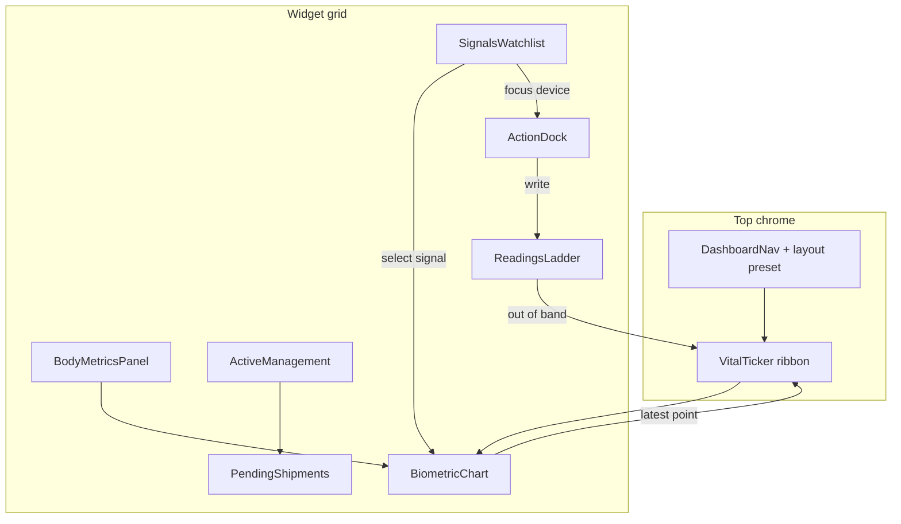

# SpryMD PT Dashboard — Kraken Pro Analog Spec

> **Status:** R&D proposal only. No production UI implementation in this doc.  
> **Audience:** Product + engineering.  
> **Baseline inspected:** `main` (`src/pages/dashboard/*`, `patientCareStore`) and `origin/cursor/wearable-dashboard-toolbar-012b` (floating toolbar, readings list, simulated sync).

---

## 1. Intent

Recast the patient (PT) account home as a **dense, multi-panel “health terminal”** that visually and structurally echoes **Kraken Pro**, while remaining clinically appropriate for SpryMD care (protocols, devices, goals, shipments).

Kraken Pro’s product DNA we borrow:

| Kraken Pro trait | SpryMD PT translation |
| --- | --- |
| Top ticker / portfolio ribbon | Live vital ticker (last HR, SpO₂, weight, BP, sleep, CGM) |
| Multi-panel widget grid | Chart + watchlist + stream + action form + balances + positions |
| Dense dark theme | Keep `#050505` / zinc / `#1EC8A5` system already on dashboard |
| Live updating feel | Simulated stream MVP → real BLE/API later |
| Layout presets (Simple / Advanced / Terminal) | Care Simple / Clinical Terminal / Device Ops |

We do **not** copy trading jargon into patient-facing copy. Mapping is structural only; UI labels stay health-native.

---

## 2. Widget mapping (trading → health)

| Kraken Pro widget | PT analog | Primary data |
| --- | --- | --- |
| Markets / Market Favorites | **Signals** — connected wearables + favorite vitals | `wearableDevices`, last reading per metric |
| Price chart (TradingView) | **Biometric chart** — selected signal over time | `wearableReadings` filtered by metric/device |
| Order book | **Readings ladder** — recent values with “bid/ask” replaced by in-range / out-of-range bands | Stream sorted by `recordedAt` |
| Market trades | **Upload / sync feed** — every ingest event | Readings with `source`: manual \| upload \| sync \| continuous |
| Order form | **Action dock** — Buy device / Upload / Set goal | Marketplace SKUs + `recordWearableReading` + body goals API |
| Balances | **Body metrics** — height, weight, BMI, composition | `bodyProfile` (new; see data-model doc) |
| Open positions | **Active management** — treatments / protocols | Existing `treatments` / `CurrentManagement` |
| Open orders | **Pending care** — pending review, refills, shipments | `clinicalCases`, `shipments`, `subscriptions` |
| Depth chart (optional) | **Goal progress depth** — distance to target bands | Goals vs latest metrics |
| Portfolio value (header) | **Health score / readiness** (optional composite) | Derived from sleep + HRV + adherence |

---

## 3. Layout wireframe

### 3.1 ASCII — Advanced / Terminal preset (desktop ≥1280px)

```
┌──────────────────────────────────────────────────────────────────────────────────┐
│ SPRYMD  │ Care │ Signals │ Orders │ Account │     Health score 78  │  PT · WM   │
├──────────────────────────────────────────────────────────────────────────────────┤
│ TICKER  HR 72▲  SpO₂ 98  WT 184.2  BP 118/76  SLEEP 82  HRV 48  CGM 112  · LIVE │
├───────────────────────────────┬────────────────┬─────────────────────────────────┤
│                               │  SIGNALS       │  ACTION DOCK                    │
│  BIOMETRIC CHART              │  (watchlist)   │  [Buy device] [Upload] [Goal]   │
│  metric tabs: HR SpO₂ WT BP   │  ● Oura · HRV  │  ─────────────────────────────  │
│  SLEEP HRV GLUCOSE            │  ● Whoop · HR  │  Device: Omron BP ▾             │
│                               │  ○ Dexcom · CGM│  Mode: Manual | Sync | Stream   │
│   ▁▂▃▅▆▇█▇▆▅▄▃▄▅▆ (candles   │  ● Withings WT │  Value: ____   Note: ____        │
│    or line+range bands)       │  ● Omron · BP  │  [Save reading]                  │
│                               │  ○ Eight Sleep │                                 │
│  TF: 1H  24H  7D  30D  90D    │  + Add device  │                                 │
├───────────────────────────────┤────────────────┤─────────────────────────────────┤
│  BODY METRICS (balances)      │ READINGS       │  ACTIVE MANAGEMENT (positions)  │
│  Ht 5'11"  Wt 184.2  BMI 25.7 │ LADDER/FEED    │  GLP-1 · active · goal −12 lb   │
│  Fat 22.1%  Goal −12 lb 68%   │ 118/76 Omron   │  HTN protocol · pending review  │
│  ████████░░ progress          │  98% SpO₂      │  Sleep stack · autoship on      │
│                               │  184.2 lb      │                                 │
│                               │  HR 72 sync    │  PENDING / SHIPMENTS (orders)   │
│                               │  CGM 112↑      │  Refill · processing · ETA Tue  │
└───────────────────────────────┴────────────────┴─────────────────────────────────┘
│ optional bottom: notifications strip · iSpry chat dock (existing)                │
└──────────────────────────────────────────────────────────────────────────────────┘
```

### 3.2 Mermaid — panel graph



### 3.3 Mobile (≤768px)

Stack vertically (Kraken “Simple” analog):

1. Ticker (horizontal scroll)  
2. Chart (full width, shorter height)  
3. Action dock (sticky bottom — replaces floating wearable toolbar pattern)  
4. Signals (horizontal chips)  
5. Readings feed  
6. Body metrics  
7. Management + shipments  

Preserve existing bottom padding for chat dock (`pb-24` pattern from wearable branch).

### 3.4 Layout presets

| Preset | Panels shown | Use case |
| --- | --- | --- |
| **Care Simple** | Chart + Management + Shipments + Action | New patients |
| **Clinical Terminal** (default R&D target) | Full grid above | Engaged PT + clinician review demos |
| **Device Ops** | Signals + Ladder + Action + Body | Heavy wearable / upload users |

MVP: CSS grid templates + localStorage layout key. Drag-resize is **phase 2** (Kraken-like but not required for first ship).

---

## 4. Component inventory

Proposed paths under `src/components/dashboard/pro/` (names illustrative):

| Component | Role | Reuses / extends |
| --- | --- | --- |
| `VitalTicker` | Horizontal live ribbon | Derived from latest `wearableReadings` + body profile |
| `SignalsWatchlist` | Device/metric favorites list with status dots | `WearableToolbar` device list + `WEARABLE_CATALOG` |
| `BiometricChart` | Time-series / candle-style range chart | New; feed from readings store |
| `ReadingsLadder` | Dense recent stream with range coloring | `WearableReadings` densified |
| `ActionDock` | Buy / Upload / Set goal tabs | Toolbar forms + marketplace deep-links |
| `BodyMetricsPanel` | Height/weight/BMI/goals progress | New `bodyProfile` model |
| `ActiveManagementPanel` | Positions analog | Existing `CurrentManagement` |
| `PendingOrdersPanel` | Open orders analog | `UpcomingShipments` + pending treatments |
| `ProDashboardGrid` | Grid shell + preset switcher | New layout wrapper around `HomePage` |
| `LayoutPresetMenu` | Simple / Terminal / Device Ops | localStorage |

Supporting hooks:

| Hook | Responsibility |
| --- | --- |
| `useVitalStream` | Interval / EventSource simulation; pushes readings when devices in `continuous` mode |
| `useSelectedSignal` | Chart + ticker selection state |
| `useBodyGoals` | CRUD wrappers around `patientCareStore` body APIs |

Types: extend `@/types/dashboard` (see `body-goals-data-model.md`). Catalog expansion: see `bioinformatic-wearables-catalog.md`.

---

## 5. Visual / interaction model

### 5.1 Theme

Stay on the existing dashboard language (do not invent a purple crypto look):

- Background `#050505`, panels `bg-white/[0.03]`, borders `border-white/10`
- Accent `#1EC8A5` for live / in-range / CTA
- Out-of-range: muted rose (`rose-400`) — sparingly, clinical not alarmist
- Typography: Syne for panel titles, DM Sans body, mono for tickers/timestamps (already used)
- Density: 12–14px panel chrome, compact row heights (~32–36px) like a terminal — denser than current card home

### 5.2 Interactions

1. **Select signal** in watchlist → chart metric + ticker highlight update.  
2. **Hover / focus reading** in ladder → chart crosshair (MVP: highlight timestamp).  
3. **Action dock Save** → append reading → ladder prepend + ticker flash.  
4. **Buy device** → navigate to marketplace filtered by Devices SKU (existing `marketplaceFilter: Devices`).  
5. **Set goal** → open inline form writing `bodyGoals` / treatment goal fields.  
6. **Sync / Stream toggle** → reuse wearable branch `setWearableSyncMode`; continuous mode enables stream simulator.  
7. **Layout preset** → swap grid template; persist per email key.  
8. **Click position (treatment)** → existing `/dashboard/goals/:id`.

Keyboard (phase 2): `1–6` metric tabs, `U` upload, `G` goal.

### 5.3 Live / “pro” feel cues

- Ticker values tick with subtle fade (no neon glow spam)
- Green pulse on “LIVE” when any device `status === monitoring`
- Chart updates every 2–5s in stream mode (simulated)
- Ladder rows insert at top with brief highlight
- Stale data: zinc-500 “as of Xm ago” when `lastSyncedAt` older than threshold

---

## 6. Realtime strategy

### 6.1 MVP (simulated stream — preferred)

Reuse and extend wearable-branch patterns:

- Devices with `syncMode: "continuous"` participate in a client-side ticker.
- `useVitalStream(email)`:
  - `setInterval` 3–5s
  - Call `syncWearableDevice` **or** a lighter `tickContinuousReading` that appends a small delta without notification spam
  - Cap store at 200–500 readings (branch already slices to 200)
- Optional: `BroadcastChannel` so multiple tabs share the illusion of one stream
- No backend required; localStorage `sprymd_patient_care_v1` remains source of truth

### 6.2 Near-term

| Source | Approach |
| --- | --- |
| Manual / CSV upload | Existing `importWearableUpload` |
| “Sync” button | Existing `syncWearableDevice` sample generator → later HealthKit/Google Fit export ingest |
| Apple Health / Health Connect | File drop or OAuth bridge (out of scope for MVP) |
| Vendor APIs (Oura, Whoop, Dexcom, Withings) | Partner OAuth; map into unified `WearableReading` |

### 6.3 Clinical safety note

Simulated continuous data must be labeled **Demo / Simulated** in UI until real device integrations are certified. Never present simulated CGM/BP as clinical truth in clinician-facing exports without a clear provenance flag (`source` + `provenance: "simulated"`).

---

## 7. Relationship to current `main` home

Current `HomePage` is a **vertical care feed**:

`GreetingHeader` → `NotificationsFeed` → `CurrentManagement` → `UpcomingShipments` → `QuickLinksFooter`

**Recommendation:** Keep that as **Care Simple** preset (or `/dashboard` classic mode). Add **Clinical Terminal** as `/dashboard` default for logged-in PT once built, or behind a “Terminal view” toggle in `DashboardNav`.

Wearable branch already adds:

- Floating `WearableToolbar` + `WearableReadings`
- Store fields `wearableDevices` / `wearableReadings`
- Sync / manual / upload / continuous modes

**Terminal view absorbs the toolbar into `ActionDock`** so the Kraken-like grid owns the chrome instead of a floating bar.

---

## 8. Phased delivery (engineering, not calendar)

| Phase | Scope | Risk |
| --- | --- | --- |
| **P0 Docs** (this R&D) | Specs + catalog + data model | None |
| **P1 Scaffold** | `ProDashboardGrid` shell, static panels, mock ticker, chart with existing readings | Low — UI only |
| **P2 Store** | Body profile + goals APIs; catalog SKU ids; stream hook | Medium — schema migration in localStorage |
| **P3 Chart quality** | Multi-metric, range bands, 7D/30D aggregates | Medium |
| **P4 Integrations** | Real vendor OAuth / file bridges | High — compliance, secrets, PHI |

---

## 9. Acceptance criteria (for a future implementation PR)

- [ ] Desktop Terminal layout shows ticker + ≥5 panels without horizontal page scroll at 1440px  
- [ ] Selecting a signal updates chart + ticker highlight  
- [ ] Continuous mode visibly updates ladder/ticker without full page reload  
- [ ] Action dock can save a manual reading into `patientCareStore`  
- [ ] Body metrics panel reads/writes height, weight, BMI, at least one goal  
- [ ] Active management still links to treatment detail  
- [ ] Simulated data clearly marked  
- [ ] Mobile stack remains usable; no overlapping chat dock  

---

## 10. Open questions

1. Default landing: Terminal vs Care Simple for first-time accounts?  
2. Composite “health score” — show or defer (risk of overclaiming)?  
3. Clinician view: same terminal read-only, or separate?  
4. Merge Goals page into Body Metrics panel vs keep `/dashboard/goals` as treatment list?

---

## Related docs

- [`bioinformatic-wearables-catalog.md`](./bioinformatic-wearables-catalog.md) — sellable SKUs & metrics  
- [`body-goals-data-model.md`](./body-goals-data-model.md) — store extension design  
