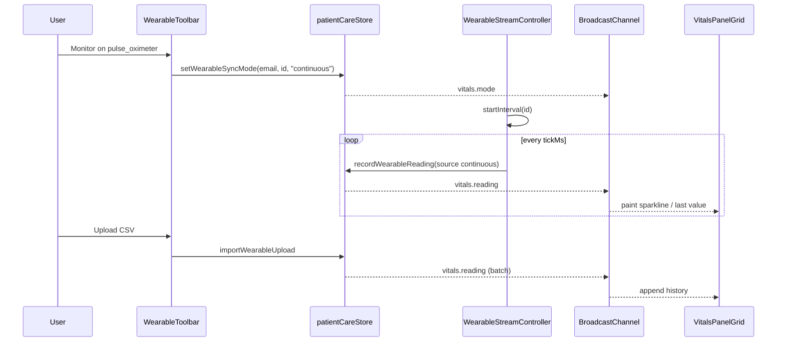

# Realtime Vitals Architecture (R&D)

> **Status:** Research only — no production code in this doc.  
> **Repo:** `wbmerrick/sprymd.ai` (Vite + React + localStorage `patientCareStore`, Supabase client available).  
> **Upstream wearable UI:** branch `cursor/wearable-dashboard-toolbar-012b` (not on `main`).

## 1. Problem statement

Patient dashboard users should be able to:

1. **Buy** top bioinformatic / home devices in the Spry marketplace (`Devices` SKUs `p8`–`p10`, plus sleep/CPAP accessories).
2. **Upload** device exports (CSV / JSON) or enter readings manually.
3. **See** those readings update in front of them in near-realtime (Kraken-style multi-panel vitals board).
4. **Manage** devices, care goals, and anthropometrics (height / weight).

Today on `main`: care store + auth-gated `DashboardLayout`, goals/management, marketplace cart → `recordCartCheckout`. No wearable types, no live panels, no height/weight vitals profile.

On `cursor/wearable-dashboard-toolbar-012b`: floating `WearableToolbar`, `WearableReadings` list, store APIs for sync/manual/upload, and `syncMode: "continuous"` **flag only** — no browser stream simulator yet.

## 2. Design principles

| Principle | Implication |
|-----------|-------------|
| Auth stays sacred | All vitals UI mounts **inside** `DashboardLayout` after `ready && isAuthenticated`. Never bypass `Navigate` to `/?auth=1`. |
| localStorage-first MVP | Persist under `sprymd_patient_care_v1` like the rest of care; do not require Supabase tables for the first ship. |
| Simulation ≠ fake clinical claim | Continuous mode is an **in-browser stream simulator** (or replay of uploaded series), clearly labeled `source: "continuous"`. |
| Purchase unlocks panels | Marketplace device SKUs map to wearable kinds; only **owned / enabled** devices get live panels. |
| One write path | UI never mutates readings ad-hoc — always `patientCareStore` → `refresh()` (or a vitals bus event that then writes). |

## 3. Browser realtime simulation options

MVP does **not** need WebSockets. Three patterns fit this stack; combine them.

### 3.1 `setInterval` / `requestAnimationFrame` (primary continuous mode)

**Use when:** user toggles Monitor on a device; dashboard tabs are open.

```
WearableStreamController
  ├─ for each device where syncMode === "continuous" && enabled && owned
  │    setInterval(tickMs) → sampleReadingForDevice(id)
  │                       → recordWearableReading(..., source: "continuous")
  │                       → BroadcastChannel.postMessage({ type: "vitals.reading", reading })
  └─ clearInterval on mode change / unmount / visibility hidden (optional pause)
```

| Param | Suggested MVP |
|-------|----------------|
| `tickMs` | 3–5s for SpO₂/pulse demo; 15–30s for BP/scale; 60s+ for sleep/CPAP |
| Pause | `document.visibilityState === "hidden"` → pause; resume on `visible` |
| Cap | Keep last **200** readings per patient (already on wearable branch) |
| Jitter | Small random walk around last value so charts feel alive |

**Pros:** Zero infra, works offline, easy to unit-test.  
**Cons:** Stops when tab closed; multi-tab duplicates writers unless coordinated (see BroadcastChannel).

### 3.2 `BroadcastChannel` (multi-tab / panel fan-out)

**Channel name:** `sprymd-vitals-v1`.

| Message | Payload | Producer | Consumer |
|---------|---------|----------|----------|
| `vitals.reading` | `{ email, reading }` | stream controller / upload / sync | live panels, sparkline, toast |
| `vitals.mode` | `{ email, deviceId, syncMode }` | toolbar | other tabs sync UI |
| `vitals.owned` | `{ email, deviceIds[] }` | cart checkout linker | panel grid rebuild |
| `vitals.profile` | `{ email, heightCm, weightLb }` | profile form | BMI / goals widgets |

**Leader election (optional but recommended):**

```
const id = crypto.randomUUID();
// lowest id among tabs that ping every 2s becomes leader;
// only leader runs setInterval writers; all tabs paint from channel + localStorage
```

Prevents double-writing continuous readings when two dashboard tabs are open.

### 3.3 `EventSource` (SSE) — optional bridge toward production

**Use when:** you want the **same panel subscription API** as future server push, without inventing a fake WebSocket.

MVP shim:

```
// Dev-only Vite middleware or tiny Express on :8787
GET /api/vitals/stream?email=…&device=pulse_oximeter
Content-Type: text/event-stream
data: {"metric":"SpO₂","value":98,...}\n\n
```

Client:

```ts
const es = new EventSource(`/api/vitals/stream?device=${id}`);
es.onmessage = (e) => {
  const reading = JSON.parse(e.data);
  recordWearableReading(email, { ...reading, source: "continuous" });
};
```

**Pros:** Teaches panels to subscribe to an event source; swap URL to Supabase Realtime later.  
**Cons:** Needs a local server or Vite plugin; overkill if only one browser session.

**Recommendation:** Ship MVP with **`setInterval` + `BroadcastChannel`**. Add SSE only if you want a demo that looks “networked” for investors. Defer WebSockets / Supabase Realtime to production.

## 4. File upload parsers

Wearable branch already implements `importWearableUpload` → `parseWearableFile` in `patientCareStore`. Harden and document contracts as follows.

### 4.1 Accepted formats

| Format | Detection | Shape |
|--------|-----------|-------|
| JSON array | trim starts with `[` | `[{ value, secondaryValue?, recordedAt?, metric?, unit?, note? }, …]` |
| JSON object | trim starts with `{` | single reading or `{ readings: [...] }` |
| CSV / TSV | otherwise | header row optional; delimiter `,` or `\t` |

### 4.2 Column aliases (case-insensitive substring match)

| Role | Header aliases |
|------|----------------|
| Primary | `value`, `systolic`, `weight`, `spo`, `spo2`, `ahi`, `score`, `primary` |
| Secondary | `diastolic`, `pulse`, `fat`, `bodyfat`, `usage`, `hours`, `secondary` |
| Timestamp | `date`, `time`, `recorded`, `recordedat`, `timestamp` |

Headerless CSV: `primary[,secondary[,ISO-datetime]]`.

### 4.3 Device-specific normalization

Reuse `metricDefaults(kind)` / sample templates so uploads always land with correct `metric` + `unit`:

| `WearableKind` | Primary | Secondary |
|----------------|---------|-----------|
| `bp_monitor` | systolic mmHg | diastolic mmHg (or pulse bpm — pick one schema and stick to it; branch note uses diastolic) |
| `pulse_oximeter` | SpO₂ % | pulse bpm |
| `smart_scale` | weight lb | body fat % |
| `cpap` | AHI events/hr | usage hr |
| `sleep_tracker` | sleep score /100 | hours asleep |

### 4.4 Continuous replay from upload

Optional “Replay as live” mode:

1. Parse file → sorted by `recordedAt`.
2. Store as `source: "upload"` (history).
3. If user enables Monitor **and** `replayQueue` exists, stream controller emits queue points on an interval (compressed time, e.g. 1 day → 30s), then falls back to random-walk generator.

## 5. Continuous mode — end-to-end



**Gap to close vs wearable branch:** `setWearableSyncMode(..., "continuous")` only flips status to `monitoring`. Add `useWearableStream(email)` mounted once in `DashboardLayout` (post-auth) so continuous actually ticks.

## 6. Linking purchased devices → live panels

### 6.1 Marketplace SKU → wearable kind map

| Product id | Name | `WearableKind` / panel |
|------------|------|------------------------|
| `p8` | Smart Blood Pressure Monitor | `bp_monitor` |
| `p9` | Pulse Oximeter | `pulse_oximeter` |
| `p10` | Smart Body Composition Scale | `smart_scale` |
| `p5` / `p6` (optional) | CPAP masks | unlock `cpap` / `sleep_tracker` accessories, not sensors |

Catalog on wearable branch also includes `cpap` + `sleep_tracker` as always-present demo devices. For purchase-gated UX:

- Default: devices start `enabled: false` / `status: "disconnected"` until owned.
- Or: show catalog locked; unlock on checkout.

### 6.2 Checkout hook

Extend `recordCartCheckout`:

```ts
// After writing transaction…
for (const item of input.items) {
  const kind = MARKETPLACE_DEVICE_MAP[item.productId || item.id];
  if (kind) unlockWearableDevice(email, kind, { purchaseTxnId, purchasedAt });
}
```

`unlockWearableDevice` sets `enabled: true`, `status: "paired"`, pushes notification, posts `vitals.owned`.

### 6.3 Panel grid (Kraken-like)

On dashboard home (or `/dashboard/vitals`):

- One panel per **owned + enabled** device.
- Layout: CSS grid or `react-resizable-panels` (already a dependency).
- Each panel: last value, sparkline (recharts), source badge, sync-mode chip, “Upload” / “Sync now”.
- Empty owned set → CTA “Shop Devices” → `go("marketplace")` with filter `Devices`.

## 7. Management, goals, height / weight

| Concern | Existing | Vitals MVP addition |
|---------|----------|---------------------|
| Protocol management | `CurrentManagement`, `/dashboard/goals` | Keep; optionally show vitals goal chips (e.g. “BP &lt; 130/80”) on treatment detail |
| Wearable management | Toolbar on wearable branch | Add enable/disable, rename note, clear readings, unlink |
| Anthropometrics | Missing | `PatientVitalsProfile` on care record + Profile page form |

Suggested profile fields:

```ts
interface PatientVitalsProfile {
  heightCm: number | null;
  weightLb: number | null;      // also updated from smart_scale readings
  targetWeightLb?: number | null;
  sexAtBirth?: "female" | "male" | "unspecified";
  updatedAt: string;
}
```

BMI = `weightLb / (heightIn²) * 703` when both present. Smart-scale continuous/upload should call `updateVitalsProfile({ weightLb })` when metric is Weight.

## 8. MVP vs production

| Layer | MVP (browser) | Production (later) |
|-------|---------------|-------------------|
| Persistence | `localStorage` care key | Supabase tables + RLS (extend `20260728_patient_care.sql`) |
| Live stream | `setInterval` + `BroadcastChannel` | Device vendor webhooks / HealthKit bridge → Edge Function → `supabase.channel()` |
| Auth | `restoreCustomerSession` / email key | `auth.users` UUID = `patient_profiles.id` |
| Upload | Client-side parse | Virus-scan + server parse + PHI audit log |
| Continuous | Simulated / replay | True device telemetry; clinical disclaimer + consent |
| Panels | Client-only React | Same UI; subscribe to Realtime `wearable_readings` INSERT |
| Purchase link | `recordCartCheckout` → unlock | Orders table `mode: cart` + `wearable_devices.owned_via_order_id` |

### 8.1 Suggested Supabase tables (not for MVP)

```sql
wearable_devices (
  id uuid pk,
  user_id uuid references patient_profiles,
  kind text,
  sync_mode text,
  status text,
  enabled bool,
  marketplace_product_id text,
  last_synced_at timestamptz
);

wearable_readings (
  id uuid pk,
  user_id uuid,
  device_kind text,
  metric text,
  value numeric,
  unit text,
  secondary_value numeric,
  secondary_unit text,
  source text,
  recorded_at timestamptz,
  created_at timestamptz
);

patient_vitals_profile (
  user_id uuid pk references patient_profiles,
  height_cm numeric,
  weight_lb numeric,
  target_weight_lb numeric,
  updated_at timestamptz
);
```

Realtime: `supabase.channel('vitals:'+userId).on('postgres_changes', { event: 'INSERT', table: 'wearable_readings' }, handler)`.

Keep the **same** panel components; swap `useWearableStream` implementation behind an interface:

```ts
interface VitalsTransport {
  start(deviceId: WearableKind): void;
  stop(deviceId: WearableKind): void;
  subscribe(cb: (r: WearableReading) => void): () => void;
}
// MvpVitalsTransport | SupabaseVitalsTransport
```

## 9. Security & clinical caution (MVP)

- Treat uploaded files as **user-entered self-report**, not FDA device data, until vendor integrations exist.
- Do not surface continuous simulator as “clinically monitored.”
- Cap upload size (e.g. 1 MB) and row count (e.g. 500) in the parser.
- PHI stays in localStorage on MVP — document that multi-device sync requires Supabase Auth.

## 10. Key APIs to add / extend on `patientCareStore`

Already on wearable branch (merge first):

- `setWearableSyncMode(email, deviceId, syncMode)`
- `syncWearableDevice(email, deviceId)`
- `recordWearableReading(email, input)`
- `importWearableUpload(email, deviceId, fileName, text)`
- `wearableDevices` / `wearableReadings` on `PatientCareRecord` + `buildDashboardForEmail`

**Add for this architecture:**

| API | Purpose |
|-----|---------|
| `unlockWearableDevice(email, kind, meta?)` | Purchase / entitlement → enable panel |
| `setWearableEnabled(email, kind, enabled)` | Management toggle |
| `getOwnedWearableKinds(email)` | Panel grid filter |
| `clearWearableReadings(email, kind?)` | Management |
| `appendContinuousTick(email, kind)` | Stream controller write (thin wrapper around `recordWearableReading` + quieter notifications) |
| `updateVitalsProfile(email, patch)` | Height / weight / target |
| `getVitalsProfile(email)` | Profile + BMI helpers |
| `linkMarketplacePurchaseToWearables(email, items)` | Called from `recordCartCheckout` |
| `listLatestReadingsByDevice(email)` | One latest per kind for panel headers |

**Hook surface (`useDashboardData`):** expose the above + `refresh`; mount `useWearableStream` in layout so continuous mode works without every page re-implementing timers.

## 11. Success criteria for MVP demo

1. Sign in → dashboard loads (auth unchanged).
2. Buy Omron / Masimo / Withings from marketplace → device unlocks on dashboard.
3. Upload CSV → readings appear in panel &lt; 1s.
4. Toggle Monitor → values tick every few seconds in the open panel (and second tab via BroadcastChannel).
5. Set height + weight on profile; scale uploads update weight; goals page still works for protocols.
